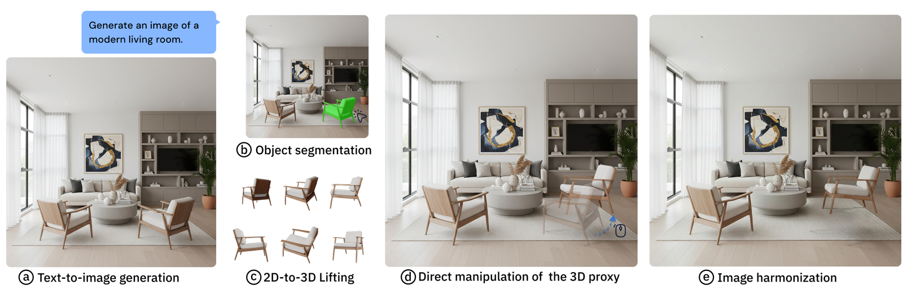
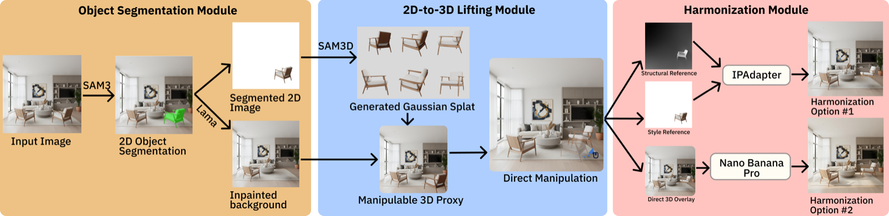
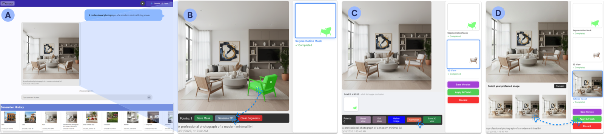
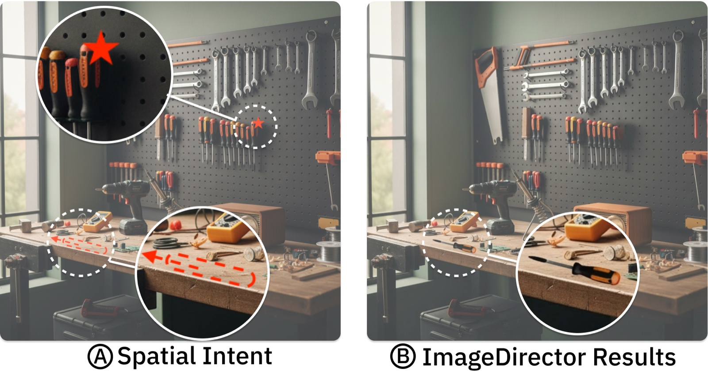
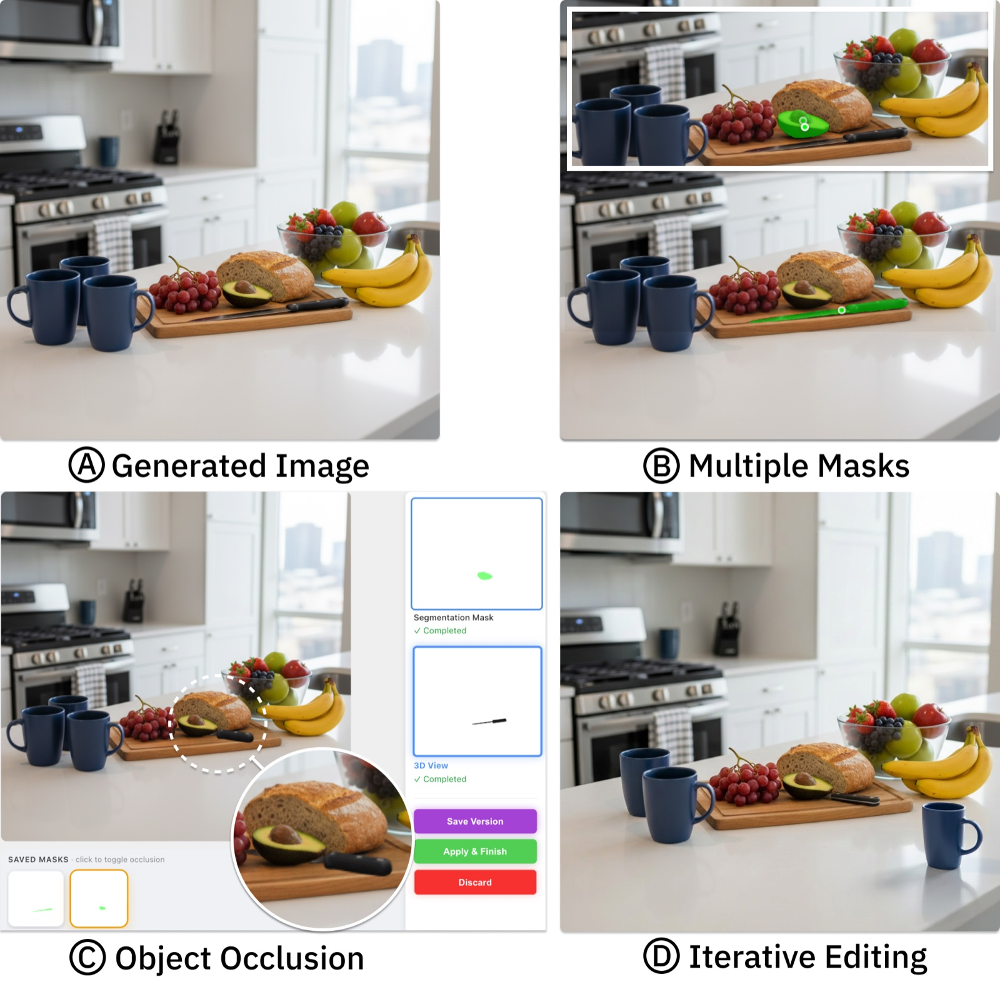

<h1 align="center">ImageDirector</h1>

<p align="center">
  <a href="https://www.linkedin.com/in/ricardomejiaaraujo/">Ricardo Mejia Araujo</a><sup>1</sup> &nbsp;·&nbsp; <a href="https://raynez.art/bio">Lei Zhang</a><sup>2</sup>
</p>
<p align="center">
  <sup>1</sup>Department of Computer Science &nbsp;·&nbsp; <sup>2</sup>Department of Informatics<br>
  New Jersey Institute of Technology
</p>
<p align="center">
  <em>ACM Symposium on User Interface Software and Technology (UIST) 2026</em>
</p>
<p align="center">
  <a href="https://raynez.art/papers/UIST26-ImageDirector.pdf"></a>
  <a href="LICENSE"></a>
</p>

<p align="center">
  
</p>

ImageDirector is a generative image editing system that enables users to manipulate objects in a 2D generated image as if they exist in 3D space. Given a generated image, our system segments a selected object, turns it into a manipulable high-fidelity 3D proxy via image-to-3D lifting, and lets users reposition, rotate, and scale it through direct manipulation. The system then re-composites and harmonizes the result with background regions preserved.

## How It Works

<p align="center">
  
</p>

The pipeline runs in three modules. **Object segmentation** takes the input image and the user's selection points, produces a segmented 2D object with SAM3, and inpaints the background it leaves behind with LaMa. **2D-to-3D lifting** turns that object into a Gaussian splat via SAM3D, giving a manipulable 3D proxy the user repositions, rotates, and scales by direct manipulation. **Harmonization** takes the structural reference, the style reference, and the direct 3D overlay, and generates candidate composites through IP-Adapter and Nano Banana Pro.

## Interface

<p align="center">
  
</p>

(A) Generate an image from a text prompt, with past generations kept in the history strip. (B) Click points on the object to segment it. (C) Manipulate the 3D proxy, toggle saved masks, and refine or harmonize. (D) Pick a preferred result among the refined options.

## Requirements

Running the interface and generating images needs only the first two. The 3D
object-manipulation pipeline additionally needs the GPU machine described under
[GPU Server](#gpu-server).

| | Version | Notes |
|---|---|---|
| Node.js | 20.x | For the React frontend (React 19, `react-scripts` 5). |
| Python | 3.13 | For the Flask backend. |
| API keys | — | A Gemini key and an OpenAI key, set in `server/.env`. |
| GPU | NVIDIA A100 80GB | Only for the four model servers. CUDA plus `conda` for their environments, and `tmux` if you use `run_servers.sh`. |

## Installation

### Environment Setup

A `.env` file is required to store API keys and configuration values, located in `server/.env`:

```bash
# Backend Environment Variables
GEMINI_API_KEY=              # Google models: gemini-3-pro-image, gemini-3.1-flash-image, gemini-3.1-flash-lite-image, gemini-2.5-flash-image (Nano Banana)
OPENAI_API_KEY=              # OpenAI models: gpt-image-2, gpt-image-1
VM_IP_ADDRESS=
```

**`GEMINI_API_KEY`** — used for all four Google image models. Get a key from [Google AI Studio](https://aistudio.google.com/apikey), or create/manage one directly on the Google Cloud [Credentials page](https://console.cloud.google.com/apis/credentials).

**`OPENAI_API_KEY`** — an [OpenAI API key](https://platform.openai.com/api-keys) with access to image generation, used for the GPT-Image 1/2 models.

**`VM_IP_ADDRESS`** — the IP address of the GPU VM running the AI models described below (i.e., segmentation, 3D reconstruction, inpainting, and harmonization).

### Backend

```bash
cd server
python3 -m venv venv
source venv/bin/activate
pip install -r requirements.txt
python image_generator.py
```

### Frontend

From the repository root:

```bash
npm install
npm start
```

The frontend expects the backend at `http://localhost:5000`. To point it elsewhere, set `REACT_APP_API_URL` in a `.env` file at the repository root.

The `/tasks` page and the `/api/save_session` endpoint are the harness we used for the user study. They are not needed to use the editor.

### GPU Server

The four model servers (SAM3, SAM-3D-Objects, LaMa, IP-Adapter) run on a GPU machine with an NVIDIA A100 (80GB). See the [GPU Server README](./GPU-Server/README.md) for setup. Once installed, start all four with:

```bash
cd GPU-Server
./run_servers.sh
```

The backend reaches them at `VM_IP_ADDRESS` on ports 5001, 5002, 5003, and 5007, so make sure the VM's firewall allows those ports from the machine running the backend.

<!-- ## Example Results

<p align="center">
  
</p>
<p align="center"><em>(A) Spatial intent. (B) ImageDirector result: the object is repositioned and the background is preserved.</em></p> -->

<!-- <p align="center">
  
</p>
<p align="center"><em>Multiple masks, occlusion handling, and iterative editing on a single scene.</em></p> -->

## Citation

If you use this code in your research, please cite our paper:

```bibtex
@inproceedings{mejiaaraujo2026imagedirector,
  author    = {Mejia Araujo, Ricardo and Zhang, Lei},
  title     = {ImageDirector: Expressing Spatial Intent via 3D Direct Manipulation for Generative Image Editing},
  booktitle = {The 39th Annual ACM Symposium on User Interface Software and Technology (UIST '26)},
  year      = {2026},
  publisher = {ACM},
  numpages  = {14},
  doi       = {10.1145/3830398.3830709},
  url       = {https://doi.org/10.1145/3830398.3830709}
}
```

## License

This project is released under the [MIT License](LICENSE). The files under `GPU-Server/inference-servers/*-custom/` are added to or modify third-party projects ([SAM3](https://github.com/facebookresearch/sam3), [LaMa](https://github.com/advimman/lama), [SAM-3D-Objects](https://github.com/facebookresearch/sam-3d-objects), [IP-Adapter](https://github.com/tencent-ailab/IP-Adapter)); files derived from those projects remain under their original licenses. Model weights are subject to the terms of their respective providers.
